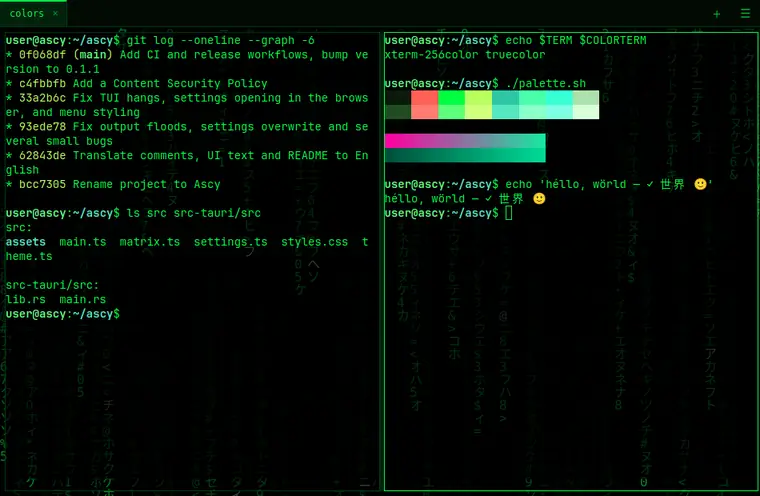
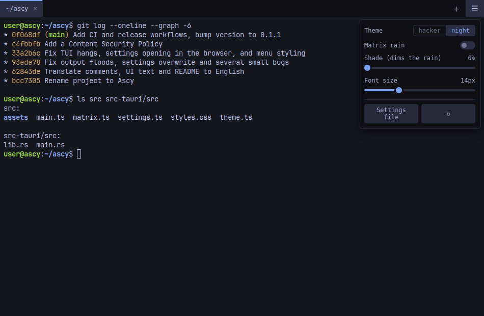

# Ascy

[](https://github.com/otabek-dev365/ascy/actions/workflows/ci.yml)
[](LICENSE)

*Pronounced "ASK-ee", like ASCII.*

A hacker-style terminal emulator built with Tauri 2 (Rust) and xterm.js 6:
black background, phosphor-green text and an optional Matrix rain behind it.



> **Platform:** Linux only for now (the working directory of a shell is read
> from `/proc`).

## Install

Download the latest `.deb` or `.AppImage` from
[Releases](https://github.com/otabek-dev365/ascy/releases):

```bash
sudo apt install ./Ascy_*_amd64.deb                # Debian, Ubuntu and derivatives
chmod +x Ascy_*.AppImage && ./Ascy_*.AppImage      # any distro
```

Or build it yourself — see [Building](#building).

## Features

- Tabs and split panes (nested, resizable with the mouse); double-click a tab
  to rename it, drag it to reorder
- Two themes: `hacker` and `night` (Tokyo Night style)
- Matrix rain background with an adjustable shade
- New tabs and panes open in the active shell's directory
- Scrollback search; URLs open with Ctrl+click
- Asks before closing a tab where a program (vim, ssh, …) is still running
- Drag & drop a file to type its path into the shell
- JSON settings file, applied live without a restart
- ☰ menu: theme, matrix toggle, shade and font size sliders



## Keyboard shortcuts

| Keys | Action | Name in settings |
|---|---|---|
| `Ctrl+Shift+T` | New tab | `new-tab` |
| `Ctrl+Shift+W` | Close pane | `close-pane` |
| `Ctrl+PgDn` / `PgUp` | Next / previous tab | `next-tab` / `prev-tab` |
| `Alt+1..9` | Jump to tab N | `go-to-tab-1` … `go-to-tab-9` |
| — (double-click the tab) | Rename tab | `rename-tab` |
| `Ctrl+Shift+E` / `O` | Split side by side / stacked | `split-right` / `split-down` |
| `Alt+←→↑↓` | Move between panes | `focus-left` / `-right` / `-up` / `-down` |
| `Ctrl+Shift+C` / `V` | Copy / paste | `copy` / `paste` |
| `Ctrl+Shift+F` | Search (Enter — next, Shift+Enter — previous, Esc — close) | `search` |
| `Ctrl` + `=` / `-` / `0` | Font bigger / smaller / reset | `zoom-in` / `zoom-out` / `zoom-reset` |
| `Ctrl+Shift+M` | Toggle matrix rain | `toggle-matrix` |
| `Ctrl+Shift+P` | Next theme | `next-theme` |
| `Ctrl+,` | Open the settings file in your default text editor | `open-settings` |
| `Ctrl+Shift+R` | Reload settings | `reload-settings` |

Bindings follow the physical key, so they work the same with any keyboard
layout. To change them, add `keybindings` to the settings file — your
entries go on top of the defaults, and `null` removes one:

```json
"keybindings": {
  "ctrl+t": "new-tab",
  "ctrl+shift+t": null,
  "alt+1": null
}
```

Keys are written as modifiers (`ctrl`, `alt`, `shift`, `super`) plus one
key: a letter, a digit, `f1`…`f12`, `left`/`right`/`up`/`down`,
`pageup`/`pagedown`, `home`/`end`, `enter`, `tab`, `space`, `escape`,
`comma`, `period`, `minus`, `equal`, `slash`, `numpadadd`, ….

## Settings

`~/.config/uz.otabek.ascy/settings.json` (created on first run, applied with
`Ctrl+Shift+R`):

```json
{
  "fontFamily": "\"JetBrains Mono\", \"Fira Code\", \"DejaVu Sans Mono\", monospace",
  "fontSize": 14,
  "theme": "hacker",
  "matrix": true,
  "shade": 0.28,
  "scrollback": 10000,
  "confirmClose": true,
  "keybindings": {},
  "themes": {}
}
```

| Key | Meaning |
|---|---|
| `fontFamily` | CSS font list |
| `fontSize` | Font size in px (8–28) |
| `theme` | `"hacker"`, `"night"` or one of your `themes` |
| `matrix` | Matrix rain background on/off |
| `shade` | How much the rain is dimmed: `0` (none) … `0.9` (almost black) |
| `scrollback` | Number of history lines kept per pane |
| `confirmClose` | Ask before closing a pane, tab or window where a program (vim, ssh, …) is still running |
| `keybindings` | Your key bindings, see [Keyboard shortcuts](#keyboard-shortcuts) |
| `themes` | Your own themes, see below |

### Themes

A theme starts from a built-in one (`base`, default `night`) and replaces the
colors you list — any [xterm.js theme color](https://xtermjs.org/docs/api/terminal/interfaces/itheme/)
plus `accent` for the active tab, focused pane and sliders. The tab bar and
borders are derived from `background` and `foreground`.

```json
"theme": "ocean",
"themes": {
  "ocean": {
    "base": "night",
    "background": "#0b1622",
    "foreground": "#d8e4f0",
    "cursor": "#5fd7ff",
    "accent": "#5fd7ff",
    "blue": "#4fa3ff"
  }
}
```

Your themes also appear in the ☰ menu and in the `Ctrl+Shift+P` rotation.

## Building

Requirements: Node.js, Rust ([rustup](https://rustup.rs)) and the
[Tauri prerequisites for Linux](https://v2.tauri.app/start/prerequisites/)
(`libwebkit2gtk-4.1-dev`, plus `librsvg2-dev` for packaging).

```bash
npm install               # first time only
npm run tauri dev         # development mode with hot reload
npm run tauri build       # release build + .deb package
```

The package lands in `src-tauri/target/release/bundle/deb/`.
Install with `sudo apt install ./Ascy_*.deb`, remove with `sudo apt remove ascy`.

### Releasing

Bump the version in `package.json` and `src-tauri/Cargo.toml`, then push a
tag like `v0.1.2`. GitHub Actions builds the `.deb` and `.AppImage` and
attaches them to a draft release — review it on GitHub and publish.

## Project layout

```
src/                      # frontend (TypeScript)
  main.ts                 #   tabs, panes, shortcuts, menu, search
  theme.ts                #   themes (hacker, night)
  matrix.ts               #   Matrix rain (canvas)
  settings.ts             #   loading/saving settings
src-tauri/src/lib.rs      # backend (Rust): PTY sessions, settings commands
src-tauri/icons/icon.svg  # icon source (sizes generated with `npx tauri icon`)
.github/workflows/        # CI checks and tagged releases
docs/                     # README images
```

## Technical notes

- xterm.js ignores alpha in the theme background, so in matrix mode the
  transparency comes from CSS (`body.matrix`) and the `#shade` overlay; the
  WebGL renderer is disabled in that mode (it comes back when matrix is off).
- Shell output is streamed to the webview as raw bytes over a Tauri channel
  with flow control: the frontend acknowledges what xterm.js has processed,
  and the backend stops reading from the PTY while more than 1 MiB is
  unacknowledged. A flood like `yes` slows the program down instead of
  freezing the window.
- The release build runs under a Content Security Policy: only the app's own
  scripts and Tauri IPC connections are allowed (inline styles too, since
  xterm.js creates `<style>` elements at runtime).
- The webview's clipboard API doesn't work in WebKitGTK, so
  `tauri-plugin-clipboard-manager` is used instead.

## License

[MIT](LICENSE)
