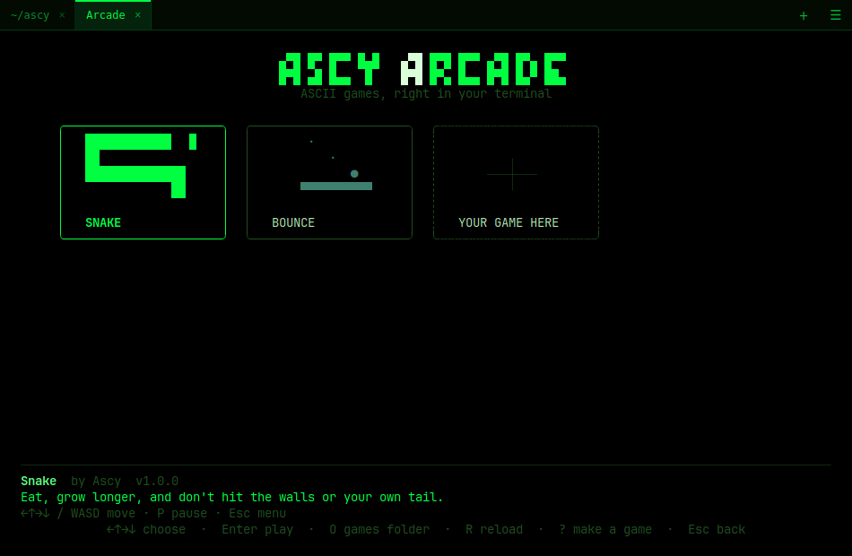

# Making games for Ascy

Ascy has a built-in arcade: press **`Ctrl+Shift+G`** to open the game list.
Games are written for Ascy itself and are drawn with text — every character
(letters, box drawing `─│╭`, blocks `█▀▄`, braille `⣿`, CJK, …) is allowed;
pictures are not. A game is one JavaScript file plus a small `game.json`.



## Quick start

1. Copy [`examples/games/bounce`](../examples/games/bounce) — the smallest
   game — to a folder of your own, e.g. `my-game/`.
2. Edit `game.json` (name, description, cover) and `main.js`.
3. Open the arcade (`Ctrl+Shift+G`) and **drag the folder onto the window**.
   It's copied to `~/.local/share/uz.otabek.ascy/games/my-game/`. You can also
   put it there yourself: `O` in the game list opens that folder.
4. Pick the game and press `Enter`. The code is read again on every start, so
   while working on a game in the games folder: edit, `Esc`, `Enter`.

The folder name becomes the game's id: lowercase letters, digits, `-`, `_`
and `.` only.

## game.json

```json
{
  "api": 1,
  "name": "Bounce",
  "author": "Your name",
  "version": "1.0.0",
  "description": "One line about the game.",
  "controls": "←↑→↓ move · Space jump · Esc back",
  "color": "brightCyan",
  "score": "higher",
  "cover": [
    "    ·         ",
    "       ·      ",
    "          ●   ",
    "   ▀▀▀▀▀▀▀▀▀▀ "
  ]
}
```

| Field | Meaning |
|---|---|
| `api` | The game API version the game is written for — `1` |
| `name`, `author`, `version` | Shown in the game list |
| `description`, `controls` | Shown under the list when the game is selected |
| `cover` | Up to 4 lines of up to 20 characters: the picture on the game's card |
| `color` | Color of the cover (see [Colors](#colors)) |
| `score` | `"higher"` (default) or `"lower"` is better — for the best score |
| `main` | The code file, `main.js` by default |

## The game

```js
ascy.game({
  init(g, size) {},          // once at the start; size = { width, height }
  update(g, input, dt) {},   // every frame: input and time (dt = seconds)
  draw(g, screen) {},        // every frame: draw everything
  resize(g, size) {},        // the pane changed size (optional)
});
```

`g` is an empty object that belongs to your game: keep all your state in it.
Frames come at the display's rate (usually 60 per second) while the game is
on screen; when its tab is hidden or the window is minimized, the game simply
pauses. Move things by `dt` (`x += speed * dt`), not by frame.

### screen

The screen is a grid of character cells, `screen.width` × `screen.height`,
the size of the pane. Coordinates start at the top left, `(0, 0)`. Drawing
outside the grid is ignored.

| Method | |
|---|---|
| `screen.clear(bg?)` | Blank everything (start `draw` with it) |
| `screen.put(x, y, char, fg?, bg?, style?)` | One character |
| `screen.text(x, y, text, fg?, bg?, style?)` | A string; `"\n"` starts the next line. Returns the x after it |
| `screen.center(y, text, fg?, bg?, style?)` | A string centered on row `y` |
| `screen.fill(x, y, w, h, char, fg?, bg?, style?)` | Fill a rectangle |
| `screen.box(x, y, w, h, fg?, bg?, style?)` | A rounded border `╭─╮` |

Terminal cells are about twice as tall as wide: two characters side by side
(`"██"`) make a square.

### Colors

- Palette names: `black`, `red`, `green`, `yellow`, `blue`, `magenta`, `cyan`,
  `white`, `gray`, `brightRed`, `brightGreen`, `brightYellow`, `brightBlue`,
  `brightMagenta`, `brightCyan`, `brightWhite`. These follow the user's theme,
  so the game fits in — green in the `hacker` theme is the Matrix green.
- `"#rrggbb"` or `"#rgb"` for an exact color; a number `0`–`255` for the
  256-color palette; `undefined` / `"default"` for the theme's own colors.

Styles: `"bold"`, `"dim"`, `"italic"`, `"underline"`, `"reverse"` —
combine them with spaces: `"bold underline"`.

### Characters

Any text character works. Wide characters (CJK) take two cells — leave the
next cell empty. Colorful emoji are pictures, not text: they show as `?`.

### input

| | |
|---|---|
| `input.held(key)` | The key is down right now |
| `input.pressed(key)` | The key went down since the last frame (key repeat doesn't count) |
| `input.released(key)` | The key went up since the last frame |
| `input.typed` | Text typed since the last frame (for names, chat, …) |
| `input.mouse` | `{ x, y, down, pressed, released, button, wheel }` in cells |

Unlike programs in a normal terminal, a game sees keys going down **and** up,
and any number of them at once.

Key names follow the physical key, so they're the same on every keyboard
layout: `a`…`z`, `0`…`9`, `up`, `down`, `left`, `right`, `space`, `enter`,
`escape`, `tab`, `backspace`, `shift`, `ctrl`, `alt`, `meta`, `f1`…`f12`,
`home`, `end`, `pageup`, `pagedown`, `insert`, `delete`, `minus`, `equal`,
`comma`, `period`, `slash`, `semicolon`, `quote`, `backquote`, `bracketleft`,
`bracketright`, `backslash`, `numpad0`…`numpad9`, `numpadadd`, `numpadenter`, ….
Ascy's own shortcuts (`Ctrl+Shift+…`, `Alt+1`…) don't reach games.

### Saving and scores

| | |
|---|---|
| `ascy.storage.get(key)` / `ascy.storage.set(key, value)` | Data kept between runs (JSON values, up to 256 KiB) |
| `ascy.score(n)` | Report the score of a finished round; Ascy keeps the best one |
| `ascy.best` | The best score so far, or `null` |
| `ascy.exit()` | Back to the game list (offer it on `Esc`) |

## The sandbox

Every game runs in its own Web Worker: it can't read or write files, reach the
network, or touch the terminal or the rest of the app. That's what makes it
safe to play a game someone sent you. In practice:

- The game is one script, not an ES module (no `import` / `export`). To write
  a bigger game in several files, bundle them into one:
  `esbuild src/main.js --bundle --format=iife --outfile=main.js`.
- No `fetch`, no `eval` / `new Function`, no DOM. `Math`, `JSON`, typed arrays,
  `performance.now()` and the rest of plain JavaScript are there.
- A game that doesn't finish a frame for 5 seconds is stopped. Errors are
  shown with the line in `main.js`, and `Esc` goes back to the list.

## Making a game with an AI

The API is small on purpose, so you can describe it to an AI in one go. Give
it this page (or its link) and something like:

> Write a game for the Ascy terminal arcade, following the guide at
> https://github.com/otabek-dev365/ascy/blob/main/docs/games.md.
> The game: *(describe it)*. Use only text characters, keep all state in `g`,
> move things by `dt`, handle `resize`, and offer `Esc` to go back with
> `ascy.exit()`. Give me `main.js` and `game.json` with a 4-line cover.

## Sharing

A game is just its folder: zip it, or put it in a Git repository. To play,
drag the folder onto the arcade window. A shared catalog of Ascy games is
planned.
